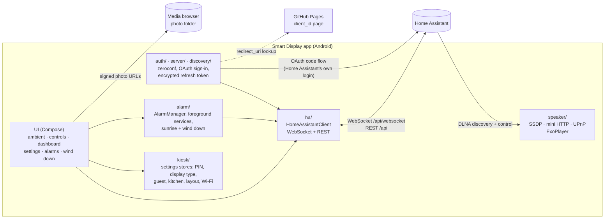

# Smart Display for Home Assistant

An Android app that turns a spare tablet or phone into an always-on smart display for
[Home Assistant](https://www.home-assistant.io/), in the spirit of a Nest Hub. Install it, sign in with your
normal Home Assistant login, and you get a clock, weather, photos, room controls, a family dashboard, alarms
and a speaker. There is no dashboard to build, no kiosk browser to buy and no server in between: the app talks
to your own Home Assistant over your network.

> Early test build. It works on the devices it has been tried on, but it is not yet in any app store and some
> features have not been checked against real hardware. See "What is still unverified" below.

## Why

Google's smart displays are barely supported any more, while old Android tablets are cheap and plentiful. The
usual way to reuse one is a dashboard you build yourself, shown in a paid kiosk browser, or the Home Assistant
companion app, which has no ambient mode or kiosk lockdown. This app is the turnkey, polished alternative.

## What you get

- **Ambient screen.** A large clock with the current weather and today's high and low. Your own photos, from a
  folder in Home Assistant's media browser, pan slowly behind it, with the place and date from each photo's
  EXIF. Dims at night and drifts to avoid burn-in.
- **Room controls.** Tap the clock for native controls for every room: lights with brightness, switches, media
  players, thermostats, and TV remotes (power, inputs, arrows, volume) for TVs the app knows.
- **Kitchen / family dashboard.** By day: a Skylight-style family calendar with a colour per person, who's
  home, scene and script buttons, a weather card with an hourly graph, sensors, cameras, now playing, and a
  status bar for doors, locks and alarms. Drag cards around on a grid to arrange them.
- **Guest room.** The guest sees only their room, gets a Wi-Fi QR code and can set an alarm. Settings are
  behind the owner's PIN.
- **Alarms, sunrise and wind down.** Real Android alarms that ring with the screen off and can turn on lights
  or play a sound on a speaker. A sunrise fade brings the lights up before the alarm. In the evening, wind down
  dims chosen lights towards bedtime and runs a bedtime check: unlocked doors, open garage, lights left on.
- **A speaker.** The display appears in Home Assistant as a DLNA media player, so announcements, text to
  speech and radio can play on it.
- **Kiosk.** Keep the screen on, act as the Home app, screen pinning, an exit PIN, idle dimming, and a power
  button that brings the clock back instead of leaving the kiosk.

## Architecture

A single Android module written in Kotlin with Jetpack Compose. No separate backend.



How the pieces fit:

- **Sign-in** uses Home Assistant's own login page in the browser. The app's OAuth `client_id` is a tiny page
  hosted from `docs/` on GitHub Pages that lists the app's redirect URI. Only the refresh token is stored,
  encrypted with an Android Keystore key.
- **Live data** comes over one WebSocket: entity states, state change events and the area, device and entity
  registries. Screens collect a single `HomeState`; the connection stays open while any screen is collecting.
- **Alarms** are scheduled with `AlarmManager` and run in foreground services, so they ring with the app in the
  background or the screen off, and survive reboots and app updates.
- **The speaker** is a UPnP AV MediaRenderer that Home Assistant's DLNA integration finds on the LAN.

Pure logic (models, layout maths, alarm timing, UPnP messages) is kept apart from the UI and unit-tested.

## Try it on a tablet or phone (no developer tools)

You do not need to build anything to try the app. You need an Android device running Android 8.0 or newer, on
the same Wi-Fi network as your Home Assistant, and the app's install file (an `.apk`).

### Get the APK

- From the [Releases](https://github.com/kjk12346/smart-display/releases) page, once a release is published
  there. Download the `.apk` on the device itself if you can: that saves copying it across.
- Or from whoever built it for you. The file will be called something like `app-debug.apk` or
  `app-release.apk`. Get it onto the device by USB cable, a cloud drive, a chat message or email.

### Install it

1. Open the `.apk` on the device: from the browser's download notification, or find it with the Files app.
2. Android asks whether to allow installs from that app (Chrome, Files, Drive...). Allow it for this source,
   then go back and tap **Install**. On Android 8 and 9 this is a one-time setting; newer versions ask per
   source.
3. If Play Protect warns that it does not recognise the app, choose **Install anyway**. The app is not in any
   store yet, so Play Protect has not seen it before.
4. On a Fire tablet, turn on **Settings > Security & Privacy > Apps from Unknown Sources** for the app you
   open the file from (Silk or Files), then install.

To update later, install the newer `.apk` the same way over the top. Your sign-in, settings and alarms are
kept. If the install is refused with a signing error, the new file was built with a different key: uninstall
the old one first, then set it up again.

### Sign in and set up

1. Open the app. It looks for Home Assistant on your network. If it does not find it, type the address you
   use in the browser, such as `http://homeassistant.local:8123`.
2. Tap **Sign in**. Home Assistant's own login page opens in the browser; sign in as you normally would, then
   you are sent back to the app. No long-lived tokens to copy. For a guest-room display, make a separate
   non-admin user in Home Assistant and sign in as that user.
3. Allow **local network access** if the device asks (Android 17 and newer). The app needs it to find and
   talk to Home Assistant.
4. The clock appears. **Long-press the clock** to open Settings:
   - **Who uses this display:** Owner, Guest room or Kitchen (the family dashboard).
   - **Kiosk:** set an exit PIN first, then you can turn on Home app and screen pinning so the tablet stays on
     the display. Settings is behind the PIN from then on.
   - **Display:** a wallpaper folder from Home Assistant's media browser, the clock's position, and so on.
   - **Alarms, Winding down, Speaker, Guest Wi-Fi:** each on its own page. Use the search box at the top to
     find a setting by name.

### Things to try

Walk through these to see whether the app works with your setup. If something fails, note what you did,
what you expected and what happened instead, plus the device model and Android version, and open an issue
or tell whoever gave you the build.

- **Clock and weather.** The time, date, today's conditions and high and low match Home Assistant's weather
  entity. Leave it an hour: the clock drifts slightly (burn-in protection) and dims after 10 PM.
- **Photos.** With a wallpaper folder chosen, photos fade in behind the clock and pan slowly. The place and
  date show bottom right when the photo has them.
- **Controls.** Tap the clock, pick a room, and try a light, a switch, a media player and a thermostat.
  Changes made elsewhere (a wall switch, the Home Assistant app) show up on the display within a second or
  two. After the display goes back to the clock and you tap it again, it opens on the room you last chose.
- **Alarms.** Set one for a few minutes ahead, turn the screen off, and check it rings and wakes the screen.
  Try Snooze and Dismiss. If you chose lights for it, they come on at the ring.
- **Kiosk.** With the PIN, Home app and pinning on: press Home and Back, they should not leave the display.
  Press the power button: the screen should come straight back to the clock. Long-press the clock and
  enter the PIN to get to Settings; that is the way out.
- **Reconnecting.** Restart Home Assistant. The display shows it is reconnecting and recovers by itself.
- **Kitchen dashboard.** Switch the display type to Kitchen: the calendar, who's home, buttons and weather
  card appear. Long-press (PIN) to move or resize cards.
- **Speaker.** Turn it on in Settings > Speaker, then in Home Assistant go to Settings > Devices & services,
  add the DLNA Digital Media Renderer integration and pick the display. A text-to-speech announcement should
  play on the tablet.

If an alarm does not ring with the screen off, your device's battery manager is probably stopping the app
from starting in the background: see the note under "Install your own build" below.

## Build

The build runs from the command line. Android Studio is not required.

1. **JDK 17.** Any OpenJDK 17 build (Temurin, Microsoft, Corretto, Zulu). It must be a JDK, not a JRE, and
   `JAVA_HOME` must point at the JDK folder, the one containing `bin\javac`.
2. **Android SDK command-line tools.** Download "Command line tools only" from
   https://developer.android.com/studio and unzip so the layout is `<sdk>\cmdline-tools\latest\bin`. Use a
   path without spaces, for example `C:\android-sdk`.
3. **SDK packages.** The app compiles against platform 37.2. Package names now carry the minor version, and
   the old `sdkmanager` is deprecated in favour of the `android` CLI:
   ```
   C:\android-sdk\cmdline-tools\latest\bin\android.exe --sdk=C:\android-sdk sdk install platforms/android-37.2 build-tools/37.0.0
   ```
   Accept the licences when asked. If you will install over USB, add `platform-tools` for `adb`.
4. **Point the project at the SDK.** Create `local.properties` in the repo root (it is gitignored):
   ```
   sdk.dir=C:\\android-sdk
   ```
5. **Build.**
   ```
   gradlew.bat assembleDebug
   ```
   The first run downloads Gradle and every dependency, so it takes a while. The APK is written to
   `app\build\outputs\apk\debug\app-debug.apk`.

On macOS or Linux use `./gradlew` and the matching tool paths. A release build with your own signing key is
configured through a `keystore.properties` file (see `app/build.gradle.kts`); without one, release builds use
the debug key.

## Install your own build

Either:

- **Copy the APK** to the device (USB cable, cloud drive, email) and open it from the Files app, as described
  under "Try it on a tablet or phone" above.
- **Or over USB** with Developer options and USB debugging turned on:
  ```
  adb install -r app\build\outputs\apk\debug\app-debug.apk
  ```

Then sign in and set it up as described above.

Some makers' battery managers (TCL, Xiaomi, Huawei, Samsung) block apps from starting in the background,
which stops alarms, the sunrise and wind down. Allow the app in those settings if an alarm does not ring.

## Test

**Unit tests** cover the pure logic and run the Home Assistant client against a fake server:

```
gradlew.bat test
```

Reports land in `app\build\reports\tests\testDebugUnitTest\index.html`.

**On a device**, the things worth checking after a change, since there are no instrumented tests:

- Sign in from a fresh install, and that the display reconnects after Home Assistant restarts.
- The clock screen by day and at night, and photos if a wallpaper folder is set.
- Controls against your real lights, switches, players and thermostats.
- An alarm with the screen off, Snooze and Dismiss, and a pending alarm after reinstalling the app.
- Kiosk: the exit PIN, Home app, pinning, and the power button while pinned.

**What is still unverified**, as of this writing: Fire tablets and other old or Play-less devices, the
alarm's speaker action, the sunrise and wind-down fades on dimmable bulbs, the TV controls and the new
dashboard card types against real devices, and volume changes on the tablet reaching Home Assistant.

## Status and licence

The product name and application ID are placeholders and will change before any store release. No licence
has been chosen yet, so the code is published for reading and trying out but remains all rights reserved.
